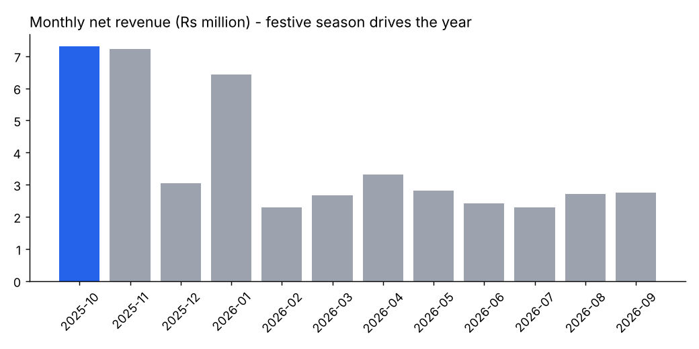
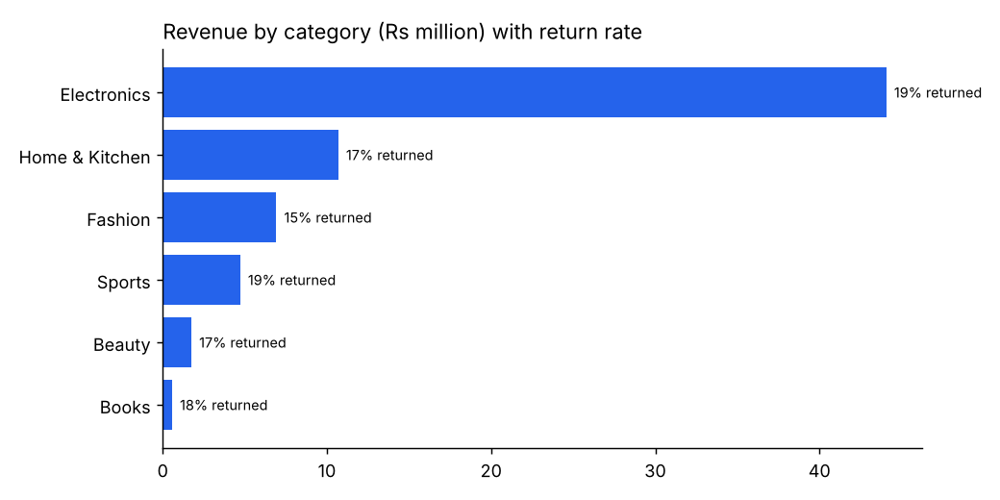
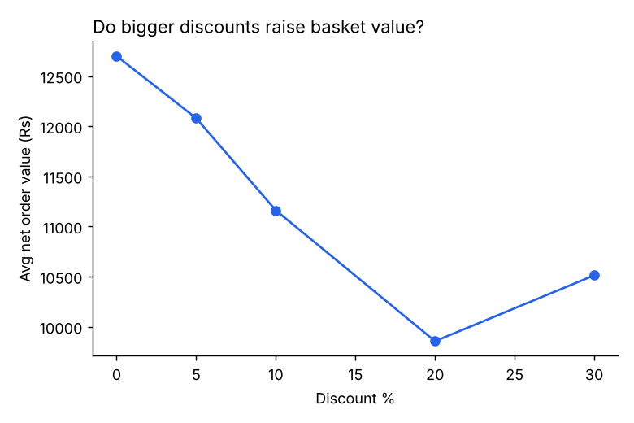
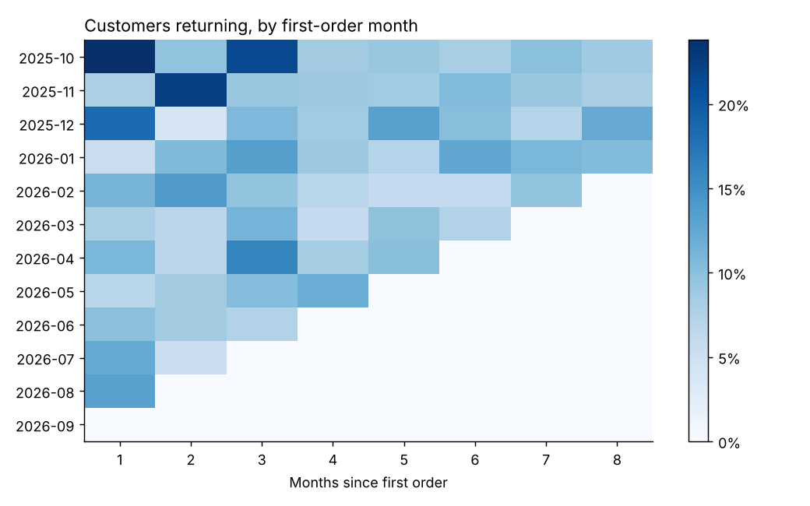
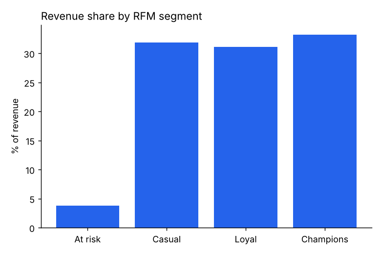

# E-Commerce Sales Analytics: End-to-End Data Analyst Project

An end-to-end analysis of a year of online orders (Oct 2025 - Sep 2026): messy raw data -> cleaning -> SQL + Python analysis -> business recommendations.

> The dataset is **synthetic** (generated by `src/generate_data.py`) so the project is fully reproducible. It is intentionally messy: duplicates, mixed date formats, inconsistent text, missing values and impossible quantities. Swap in a real dataset (Kaggle, UCI, company data) by replacing `data/raw_orders.csv` with the same columns.

## Business questions

1. When does revenue happen, and how dependent are we on the festive season?
2. Which categories drive revenue, and which have return problems?
3. Do discounts actually increase basket value?
4. Which acquisition channels bring the most valuable orders?
5. How well do we retain customers, and who are our best ones?

## Key findings

| # | Finding | Recommendation |
|---|---------|----------------|
| 1 | Oct, Nov and Jan produce ~46% of delivered revenue; the rest of the year runs at roughly a third of festive-month levels. | Plan inventory and ad budget around the festive peak; build mid-year campaigns to smooth demand. |
| 2 | Electronics is ~64% of revenue, with the highest return rate (19%) alongside Sports. | Tighten product descriptions and QC in Electronics; a 1-point return reduction there is worth more than any other category. |
| 3 | Average order value falls as discounts rise (about Rs 12.7k at 0% vs Rs 9.9k at 20%). Deep discounts are not growing baskets. | Cap blanket discounts at 10%; test targeted offers instead. |
| 4 | Referral orders have the highest average value (about Rs 12.4k); Organic the lowest. | Invest in a referral programme; it brings bigger baskets at low cost. |
| 5 | About 13% of customers ("Champions") generate a third of revenue; only ~4% of revenue comes from "At risk" customers. | Reward Champions with early access; run win-back emails on the At-risk group. |

*(Numbers come from `outputs/`; re-run the pipeline to regenerate them.)*

## Charts







## Project structure

```
.
├── data/                 raw_orders.csv, clean_orders.csv
├── src/
│   ├── generate_data.py  creates the messy dataset
│   ├── clean_data.py     cleaning + audit log (outputs/cleaning_log.csv)
│   └── analysis.py       KPIs, charts, cohort retention, RFM segmentation
├── sql/analysis_queries.sql   window functions, CTEs, ranking
├── outputs/              charts and summary tables
└── requirements.txt
```

## How to run

```bash
pip install -r requirements.txt
python src/generate_data.py
python src/clean_data.py
python src/analysis.py
```

## Skills demonstrated

Data cleaning with an audit trail, SQL (CTEs, window functions, `LAG`, `RANK`), Python (pandas, matplotlib), cohort analysis, RFM segmentation, and turning numbers into recommendations.

## Limitations

Synthetic data, so findings illustrate the method rather than a real business. Discount effect is observational, not a controlled experiment.
